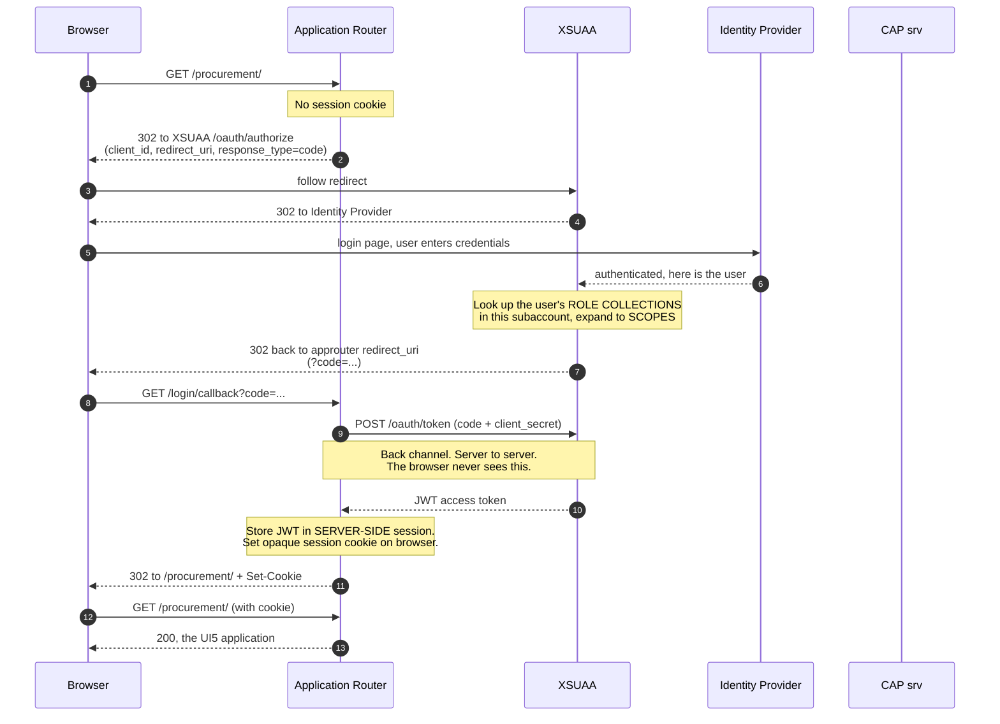
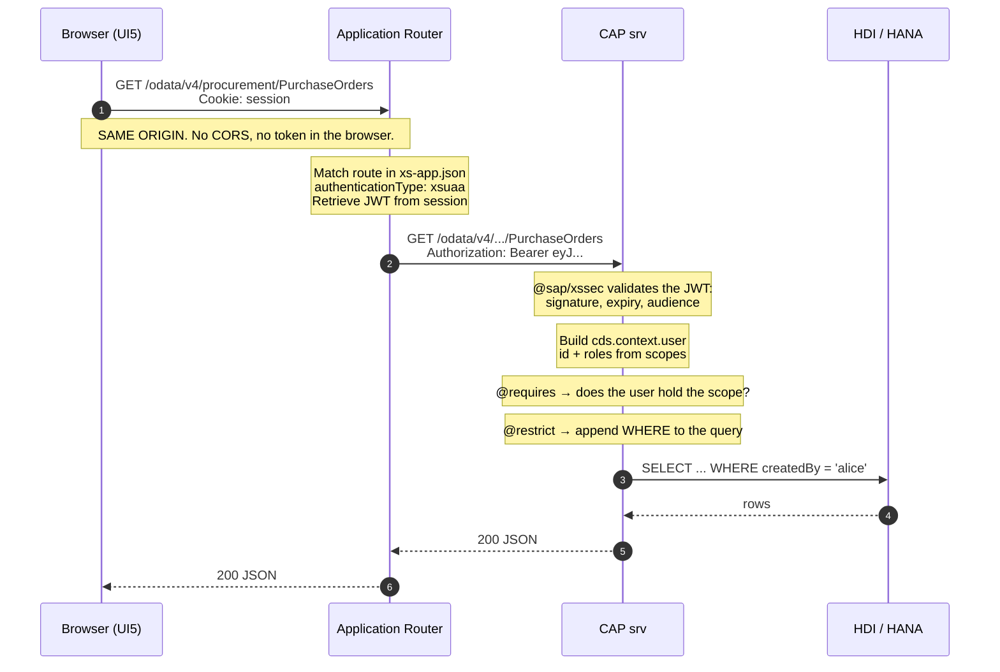

# Architecture and request flow

Status: Phase 0 Step 3
Companions: [requirements.md](requirements.md), [security-matrix.md](security-matrix.md), [adr/](adr/)

The goal of this document is that you can draw the whole system on a whiteboard
and defend every box in it — what it is, why it exists, and what breaks without it.

---

## 1. The components

| Component | What it is | Why it exists |
| --- | --- | --- |
| **Browser** | Fiori Elements + freestyle SAPUI5 apps | The user interface. Holds a session cookie — **never a token** |
| **Application Router** | A small Node.js app (`@sap/approuter`) | The single public entry point. Handles login, holds the token, forwards requests |
| **XSUAA** | OAuth 2.0 authorization server, one instance bound to our app | Issues JWTs. Translates *role collections* into *scopes* |
| **Identity Provider** | SAP ID Service by default | Actually authenticates the human. XSUAA trusts it; it does not check passwords itself |
| **CAP service (`srv`)** | Node.js, OData V4 | The business logic and the **real** authorization enforcement |
| **HDI container** | An isolated schema inside HANA Cloud | Holds the tables. Owned by the deployer, not by `srv` |
| **HTML5 App Repository** | Storage for built UI5 apps | Serves static assets so `srv` does not have to |
| **SAP Build Work Zone** | The launchpad | Where the app tiles live and roles gate visibility |
| **`db-deployer`** | A transient task module (`@sap/hdi-deploy`) | Runs once at deploy time to create tables, then exits |

Two of these surprise people:

- **`db-deployer` is not a running application.** It is a task that starts,
  creates the database artifacts, and stops. Seeing it as "stopped" in
  `cf apps` is success, not failure.
- **The Identity Provider is not XSUAA.** XSUAA decides *what you may do*. The
  IdP decides *who you are*. Keeping those separate is what lets a customer plug
  in their corporate IdP without the application changing.

---

## 2. Cloud topology

```
                        ┌──────────────────────────────────────────┐
                        │  INTERNET                                 │
                        └──────────────────┬───────────────────────┘
                                           │
                        ═══════════════════╪═══════════════════════  trust boundary
                                           │
  ┌────────────────────────────────────────▼─────────────────────────────────┐
  │  CLOUD FOUNDRY SPACE                                                      │
  │                                                                           │
  │   ┌─────────────────────────┐          the ONLY public route             │
  │   │  Application Router     │◄─────────────────────────────────           │
  │   │  (approuter)            │                                             │
  │   │  - xs-app.json routes   │                                             │
  │   │  - server-side session  │                                             │
  │   └──┬────────────┬─────────┘                                             │
  │      │            │                                                       │
  │      │ /odata/**  │ everything else                                       │
  │      │ + Bearer   │                                                       │
  │      ▼            ▼                                                       │
  │   ┌────────────┐  ┌──────────────────────┐                                │
  │   │ CAP srv    │  │ HTML5 App Repository │                                │
  │   │ OData V4   │  │ (built UI5 apps)     │                                │
  │   │ @restrict  │  └──────────────────────┘                                │
  │   └─────┬──────┘                                                          │
  │         │ SQL, as the HDI technical user                                  │
  │         ▼                                                                 │
  │   ┌──────────────┐        ┌──────────────┐                                │
  │   │ HDI container│◄───────│ db-deployer  │  transient, runs once          │
  │   │ (schema)     │        │ (task)       │                                │
  │   └──────┬───────┘        └──────────────┘                                │
  │          │                                                                │
  └──────────┼────────────────────────────────────────────────────────────────┘
             │
     ┌───────▼────────┐          ┌─────────────────┐       ┌──────────────┐
     │ HANA Cloud     │          │  XSUAA          │◄─────►│ Identity     │
     │ (own service)  │          │  (OAuth server) │       │ Provider     │
     └────────────────┘          └─────────────────┘       └──────────────┘
                                   bound to approuter
                                   AND to srv
```

### The single most important line in this diagram

**Only the Application Router has a public route.** `srv` does not. A request
from the internet cannot reach the CAP service except through the approuter.

That is why the approuter exists, and it does three jobs at once:

1. **Security perimeter.** One door, one place where authentication happens.
2. **Token custodian.** The JWT lives in the approuter's server-side session.
   The browser only ever holds an opaque session cookie.
3. **Same-origin provider.** The UI and the API are served from the *same
   hostname*, so the browser makes same-origin calls. **There is no CORS
   configuration in this project, and that is by design** — not an oversight.

If you take one thing from Step 3: a BTP app is not "a UI that calls an API".
It is a UI and an API behind a shared front door.

---

## 3. First request — the login flow

What happens when a user opens the app and has no session. This is OAuth 2.0
authorization code flow; every arrow matters.



### Where your permissions are actually decided

Step 7 of that diagram is the moment the [security matrix](security-matrix.md)
becomes real:

```
   User           assigned in BTP cockpit          defined in xs-security.json
    │                        │                                │
    ▼                        ▼                                ▼
  Person  ──────►  Role Collection  ──────►  Role Template  ──────►  Scopes
                 Procurement_Manager        Employee + Manager      $XSAPPNAME.Read
                                                                    $XSAPPNAME.Approve
                                                   │
                                                   ▼
                                        baked into the JWT, right here
```

The JWT is a **snapshot**. Change someone's role collection while they are
logged in and nothing happens until their token is reissued. That single fact
explains most "I gave them the role and it still says 403" support tickets.

---

## 4. Every request after that — the data flow

The flow that runs thousands of times a day, and the one to know cold.



### Four things worth pausing on

**The CAP service validates the token itself.** It does not trust the approuter
blindly. `srv` checks the signature against XSUAA's public key, the expiry and
the audience. Defence in depth: if someone found a way to reach `srv` directly,
a forged or stale token still fails.

**`@requires` and `@restrict` do different jobs.** This is [ADR 002](adr/002-authorization-model.md)
showing up in the request path:

| | Question | Answered from | Cost |
| --- | --- | --- | --- |
| `@requires` | May this user call this at all? | The scope in the JWT | Free — already in memory |
| `@restrict` | May this user touch **this row**? | A `WHERE` clause | A database query |

**`@restrict` narrows; it does not reject.** The `WHERE createdBy = 'alice'` is
appended to the SQL. Alice asking for Bob's order gets an empty result — a
**404, not a 403**. That is negative test #6 in the security matrix, and it is
correct behaviour: a 403 would confirm the row exists.

**The database connection is not the user.** `srv` talks to HDI as a technical
user with full access to the schema. Row-level security is enforced in the
application layer, not the database layer. So **anything holding a database
connection is inside the trust boundary** — which is exactly how `AuditLog` gets
written despite no role having `C` on it, and why that is a code-review concern
rather than an annotation concern.

---

## 5. The same system in three environments

The topology changes between local, hybrid and cloud. Knowing *which* boxes
disappear is how you debug "works locally, fails in cloud".

### Local — Phases 2, 3, 4

```
   Browser  ──►  cds watch (port 4004)  ──►  SQLite file
                 mocked auth, basic auth
```

No approuter. No XSUAA. No JWT. `cds watch` serves the UI and the OData service
from one port, so same-origin still holds. Users come from `.cdsrc.json` and
authenticate with HTTP basic auth. `@requires` and `@restrict` **are still
enforced** — against mocked users rather than real tokens.

This is why Step 25 can teach authorization properly without a cloud account.

### Hybrid — Phase 5

```
   Browser  ──►  local approuter  ──►  local cds  ──►  SQLite
                      │
                      └──►  REAL XSUAA in BTP  ──►  SAP ID Service
```

`cds bind` connects the local server to a real XSUAA instance. Real login, real
JWTs you can decode, running code you can set breakpoints in. This is the best
place in the whole project to learn authentication, and it costs nothing — XSUAA
is free, HANA is not.

### Cloud — Phase 6 onward

The full topology from section 2.

### What changes, and what does not

| | Local | Hybrid | Cloud |
| --- | --- | --- | --- |
| Auth | mocked, basic | **real XSUAA** | real XSUAA |
| Token | none | real JWT | real JWT |
| Approuter | none | local | deployed |
| Database | SQLite | SQLite | HDI / HANA |
| `@requires` / `@restrict` | **enforced** | enforced | enforced |
| Business logic | **identical** | identical | identical |

The last two rows are the point. Authorization and business logic do not change
across environments. Only *where the user identity comes from* and *where the
rows are stored* change. CAP profiles handle that, and the configuration is
written down in Step 46 so the difference is never a surprise.

---

## 6. How it fails

Knowing the flow means knowing where to look when it breaks.

| Symptom | Most likely cause | Where to look |
| --- | --- | --- |
| Redirect loop at login | approuter `redirect_uri` not in XSUAA's `oauth2-configuration` | `xs-security.json`, then the XSUAA instance |
| 401 on every OData call | JWT not forwarded — route missing `authenticationType: xsuaa` | `xs-app.json` |
| 403 for a user who "has the role" | Role collection assigned after the token was issued | Log out, log in, decode the new token |
| 403 for everyone, including Admin | Scope name mismatch between `@restrict` and `xs-security.json` | Compare the two, watch the `$XSAPPNAME.` prefix |
| Empty list, no error | `@restrict` `where` clause excluded every row | Expected behaviour — check the `WHERE`, not the auth |
| Works locally, 500 in cloud | SQLite accepted something HANA rejects | `cf logs`, then the production build output |
| CORS error in the browser | Something is being called **not** through the approuter | The UI's `manifest.json` data source |

That last row deserves emphasis. A CORS error in a correctly built BTP
application almost never means "configure CORS". It means a request escaped the
approuter, and the fix is to route it back through, not to open the browser's
security model.

---

## 7. Decisions recorded elsewhere

| Decision | Where |
| --- | --- |
| Node.js version policy across local, CI and buildpack | [ADR 001](adr/001-node-version.md) |
| Role templates, role collections, separation of duties | [ADR 002](adr/002-authorization-model.md) |
| Why items are a composition, not an association | [security-matrix.md](security-matrix.md#entity-permissions), implemented Step 14 |
| Why `AuditLog` has no `C` for any role | [security-matrix.md](security-matrix.md#entity-permissions) |
| BTP trial constraints on deployment | [requirements.md §10](requirements.md#10-target-environment-constraint-btp-trial) |
